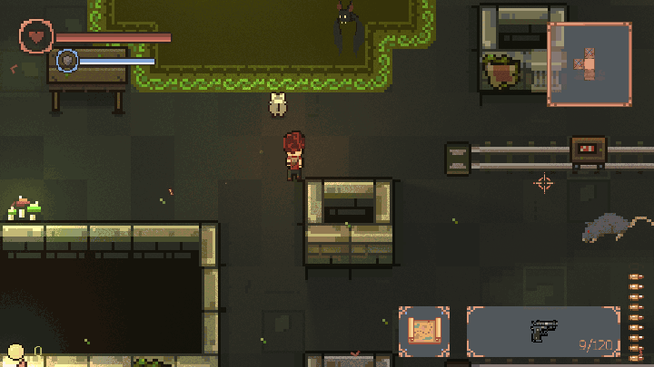
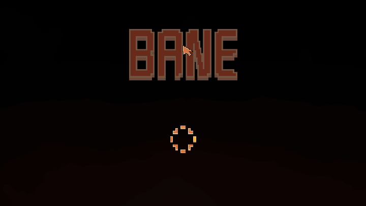

# Bane

A 2D top-down roguelike shooter in Rust. You are Elian, a test subject sent through a portal into
**the Bane** — a wound in the world whose floors rearrange themselves after every descent. Fight
through five procedurally generated floors, spend what you earn between runs, and take down the
boss at the bottom.



## What's in it

- **16 guns** — from the starting Pistol and Shotgun through Uzi, Sniper, RPG and Flamethrower to
  the Tesla Gun and Railgun. Each has its own permanent upgrade tree and a mutation at the end of it.
- **23 enemy kinds** — 13 regular enemies (rats, bats, slimes, spiders, eyes …), 3 summons and
  **7 bosses**, each with its own attack patterns and enrage phase.
- **7 biomes** — stone, sewer, moss, spider, ice, lava and temple. A biome sets the look, the
  floor liquid, the traps, the decorations, the enemies and the boss.
- **Procedural dungeons** — 8–15 rooms per floor: normal, ambush, treasure, shop, sacrifice and boss
  rooms, with arrow traps, ice, webs, lava and destructibles.
- **13 artefacts**, pickups, a shop, a slot machine, a combat pet and perks.
- **Meta-progression** — a lab between runs with a talent tree, a weapon table, a quest board with
  missions and challenges, and a story told through the bosses you meet.
- **Dodge roll**, dynamic lighting, post-processing, a minimap and a big map.

### Biomes

| | | |
|:-:|:-:|:-:|
| <br>Stone | <br>Sewer | <br>Moss |
| <br>Spider | <br>Ice | <br>Lava |
| <br>Temple | | |

### Bosses, shops and loot



| | | |
|:-:|:-:|:-:|
| <br>Boss room | <br>Shop | <br>Treasure room |

## Controls

| Input | Action |
|---|---|
| `W` `A` `S` `D` | Move |
| Mouse | Aim |
| Left mouse button | Shoot |
| `Space` | Dodge roll |
| `R` | Reload |
| `1`–`9` / mouse wheel | Switch weapon |
| `E` | Interact, pick up |
| `F` | Use artefact |
| `Q` | Drop weapon |
| `Tab` | Map |
| `Esc` | Pause |

## Run it

```bash
cd rust
cargo run --release
```

Debug knobs (`BANE_THEME=lava`, `BANE_START=dungeon`, `BANE_AT=boss`, `BANE_SEED=…`) and headless
screenshots / GIFs (`--shot`) are described in [`rust/README.md`](rust/README.md). All the pictures
above were made that way.

## How it's built

A Rust workspace in [`rust/`](rust/): `wgpu` + `winit` for the window and rendering, `hecs` ECS,
`rapier2d` physics, `kira` audio, `glam` math. A fixed 60 Hz simulation with a variable render rate;
the schedule, scenes and resources are described in
[`rust/docs/`](rust/docs/2026-10-18-ecs-refactor-notes.md).

The game started as a Java / LWJGL game and was ported to Rust; the Java code is gone from `master`
but stays in the git history.

## Docs

- [`docs/`](docs/) — the Bane wiki (Fumadocs, in Czech): every gun, enemy, artefact and biome.
- [`story.md`](story.md) — the story and its direction.
- [`tools/`](tools/) — Python scripts that generate sprites, sounds and atmosphere assets.
