<div align="center">

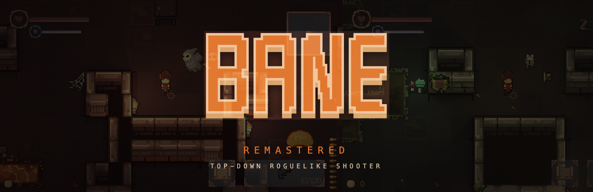

**A fast, hand-drawn top-down roguelike shooter. Five floors down. Every floor remembers you.**

[](https://www.rust-lang.org/)
[](https://wgpu.rs/)
[](https://github.com/Ralith/hecs)
[](#play-it)
[](https://empatixx.github.io/Bane-remastered/docs)
[](LICENSE)

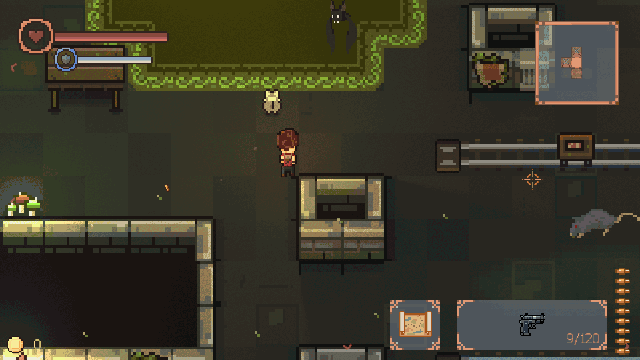

[Watch the trailer in full quality](media/trailer.mp4)

</div>

---

> **Bane Remastered is the new version of [Bane](https://github.com/Empatixx/Bane).**
> The first Bane was written in Java. It is archived now. This is the same game, built again from
> zero in Rust, with much more content.

## The Bane is open. Go in.

Something tore a hole in the world. Its floors never look the same twice. You are Elian, sent down
through the portal. Below you wait rats, slimes, spiders and things with too many eyes. At the
end of every floor waits a boss who used to be somebody.

You start with a pistol, a shotgun and a dodge roll. Everything else you have to take.

## Why one more run

**17 guns.** Pistol, Uzi, Sniper, Flamethrower, Tesla Gun, RPG, Railgun and more. Every gun has
its own upgrade tree and a mutation at the end of it.

**7 bosses with a name and a story.** A hellhound that waits at the bottom, a scribe who wrote
down every prayer, a living chest, a king of spiders. Each boss has its own attacks and gets angry
when it is losing.

**A new dungeon every time.** Rooms, traps, shops, treasure and sacrifice altars are made fresh
for every floor. There are seven biomes: Stone, Sewer, Moss, Spider, Ice, Lava and Temple.

**Loot that changes the run.** 13 one-use artefacts, a shop, a slot machine, perks and a pet that
picks up your coins. Gamble for a gun, pay for it with blood, or save your coins.

**You get stronger even when you die.** Between runs you walk around the lab. Spend talents with
the Scientist, upgrade guns at the weapon table, take quests and challenges at the quest board.

**Made to look good.** Hand-drawn pixel art, dynamic light, a different mood in every biome, a
dodge roll that feels right, screen shake and hit flashes.

## Take a look

### Seven biomes

| | | |
|:-:|:-:|:-:|
| 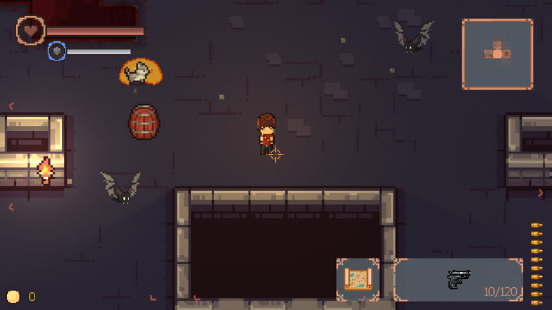<br>**Stone** | 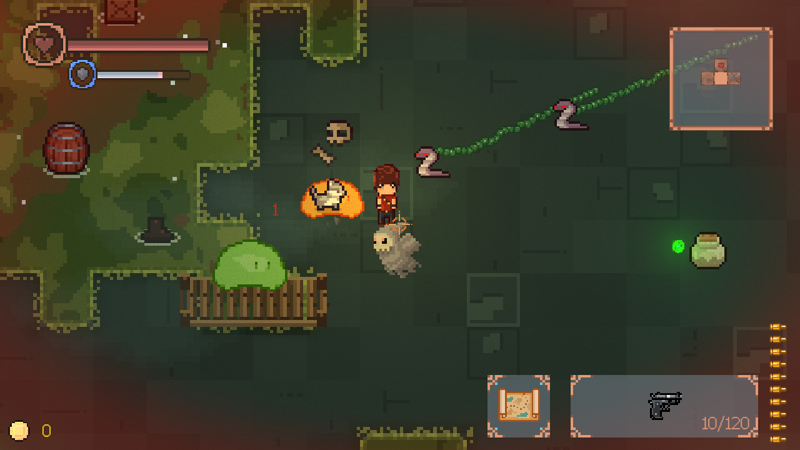<br>**Sewer** | 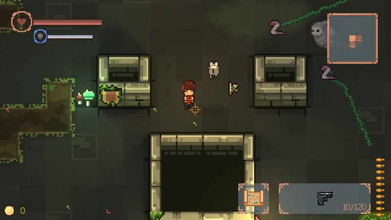<br>**Moss** |
| 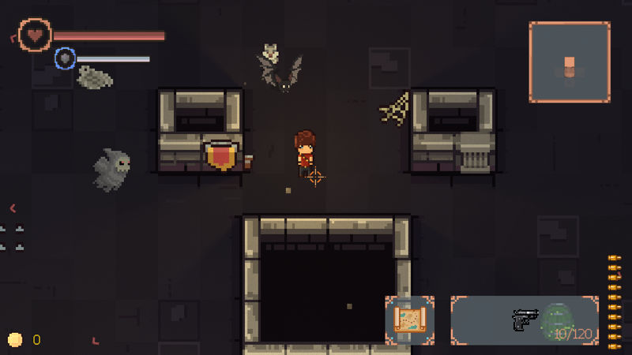<br>**Spider** | 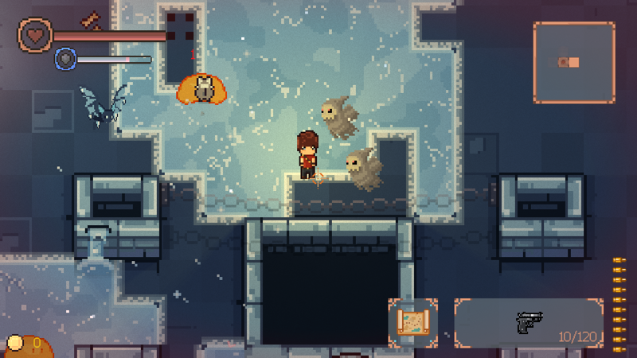<br>**Ice** | 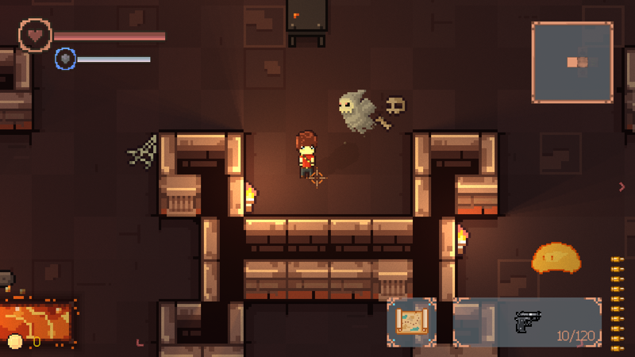<br>**Lava** |
| 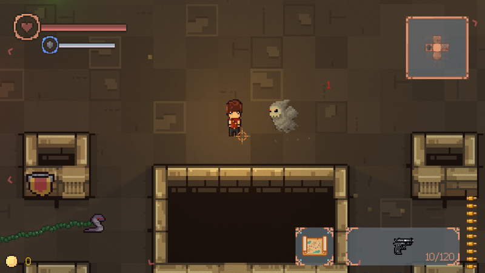<br>**Temple** | | |

### Rooms

| | | |
|:-:|:-:|:-:|
| 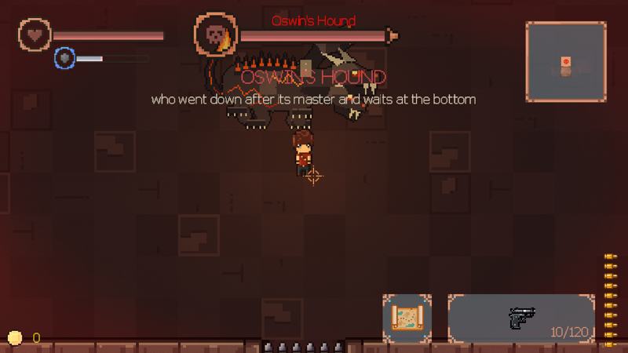<br>**Every floor ends with a boss** | 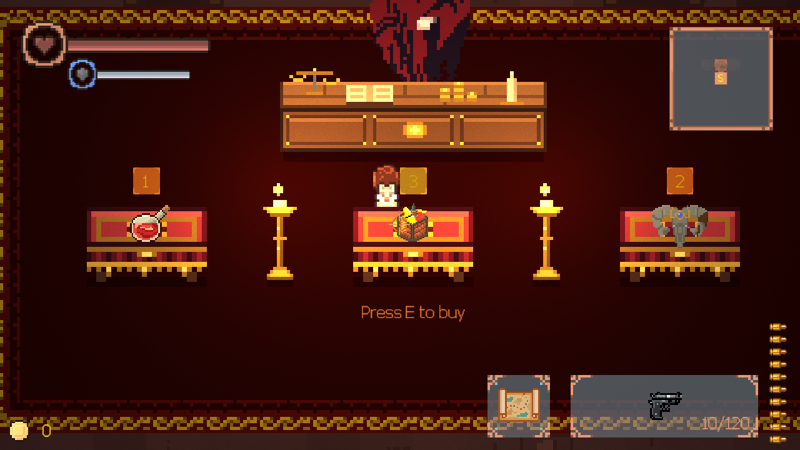<br>**Spend your coins** | 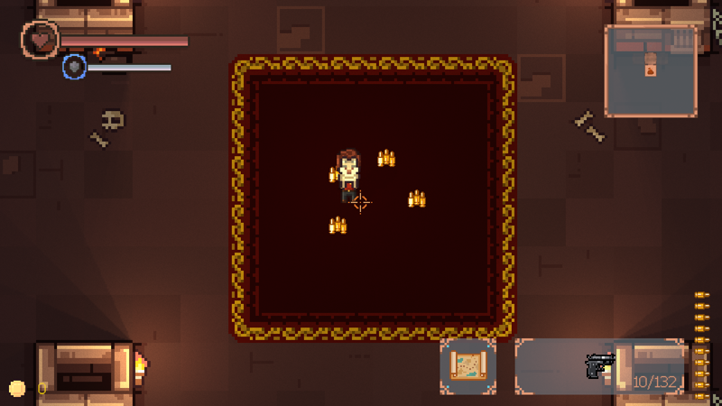<br>**Treasure for the brave** |

## From the first Bane to Remastered

| | [Bane](https://github.com/Empatixx/Bane) (Java, archived) | Bane Remastered (Rust) |
|---|---|---|
| Guns | 9 | 17 |
| Enemies | 10 kinds, bosses included | 31 kinds, 7 of them bosses |
| Artefacts | 9 | 13, made again |
| Between runs | A progress room and upgrades | A lab, talents, a weapon table, missions and challenges |
| Platform | Windows | Built and tested on macOS |

Some things from the first Bane are not here yet: floor affixes, co-op multiplayer and Discord
Rich Presence. The Modern shotgun and the Grenade launcher are not here either.

## Controls

| | |
|---|---|
| **Move** `W` `A` `S` `D` | **Aim and shoot** mouse |
| **Dodge roll** `Space` | **Reload** `R` |
| **Switch gun** `1`-`9` or mouse wheel | **Interact** `E` |
| **Use artefact** `F` | **Map** `Tab` |

All keys can be changed in the settings.

## Play it

```bash
git clone git@github.com:Empatixx/Bane-remastered.git
cd Bane-remastered/rust
cargo run --release
```

You need the [Rust toolchain](https://rustup.rs). We tested the game on macOS only.

## Wiki

The game wiki is online: **https://empatixx.github.io/Bane-remastered/docs**. Its source
is in [`docs/`](docs/). It describes every gun, enemy, artefact and biome.

## License

Bane is free software under the [GNU GPL v3](LICENSE).

---

<details>
<summary>For developers</summary>

Bane is written in Rust: `wgpu` and `winit` for graphics, `hecs` for the ECS, `rapier2d` for
physics, `kira` for audio. The simulation runs at a fixed 60 Hz.

- [`rust/`](rust/): the game. Headless screenshots, debug switches (`BANE_THEME`, `BANE_AT`,
  `BANE_SEED`) and ECS notes are in [`rust/README.md`](rust/README.md) and [`rust/docs/`](rust/docs/).
- [`tools/`](tools/): Python scripts that make sprites, sounds and atmosphere.
- [`story.md`](story.md): the story and where it goes.

</details>
